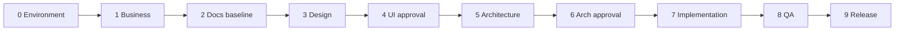

# Roadmap

> [!note] The implementation roadmap (work packages WP-00–WP-18) is proposed in [[Work-Packages]] and is approved at gate G-6.

| Phase | Deliverables | Approval |
|---|---|---|
| 2 | This vault, requirements index, glossary, traceability, status, roadmap | documentation baseline |
| 3 | Design system and screens in Claude Design | — |
| 4 | Reviewed UI/UX | complete UI/UX |
| 5 | Architecture, domain/data models, API, MCP, ADRs, implementation roadmap | — |
| 6 | Approved architecture and work packages | architecture, roadmap |
| 7 | Work packages as pull requests on `feature/*` branches | each PR reviewed by the user |
| 8 | Test reports, traceability coverage | — |
| 9 | Release checklist | release |

## MVP outline (from approved scope)

The MVP target is Windows + NVIDIA, distributed as Docker Compose with ComfyUI running natively. The native installer comes after the MVP. See [[Product-Scope]].
