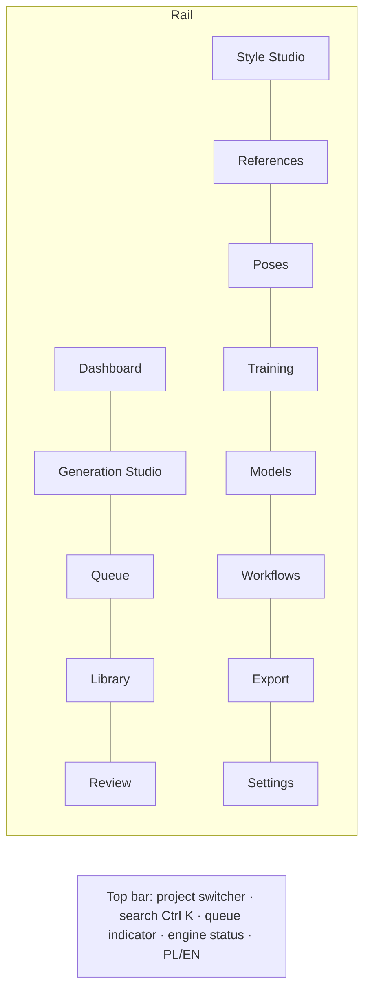

# Navigation

- **Icon rail** (56 px, left) lists the 13 modules. The active module gets an accent edge.
- **Top bar**:
  - project switcher;
  - screen title;
  - global search (Ctrl K);
  - queue indicator, which links to Queue;
  - engine status, which links to System status;
  - language switch.
- **Inspector** (right, 320–360 px): details of the selected item. Below 1024 px it becomes a drawer.
- **Phone** (< 720 px): a bottom bar with Dashboard, Review, Queue and Library. Production screens are desktop-only.
- **Keyboard:**
  - Review: A approve, R reject, ←/→ move;
  - Library: Shift/Ctrl multi-select;
  - everywhere: Ctrl K search.
- Projects live in the project switcher. Project settings sit under Settings when a project is open.
