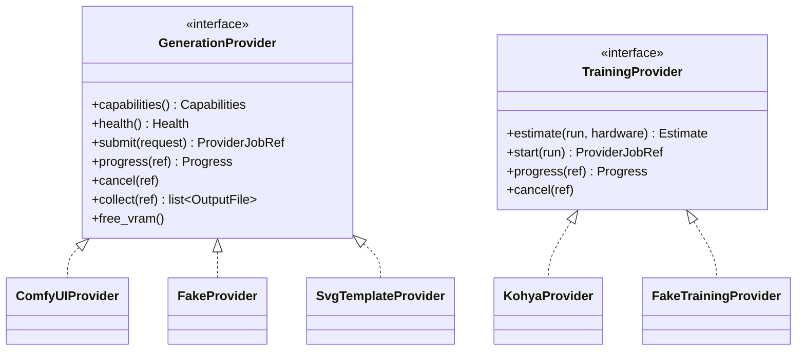

# AI Generation Architecture

## Provider adapters

- **ComfyUIProvider** (worker → ComfyUI HTTP `/prompt`, `/history`, `/view`, `/free`, plus WebSocket `/ws` for step progress).
  - It translates a domain `GenerationRequest` into ComfyUI API-format JSON using a **workflow version**: a template with declared inputs, like the prototype's `make_workflows.py`.
  - The domain never sees ComfyUI node ids.
- **SvgTemplateProvider:** deterministic SVG from versioned templates. It runs in-process with no GPU, is sanitized, and is rasterized with `resvg`.
- **FakeProvider:** returns generated test images with configurable delays and failures, for CI and UI development.
- **KohyaProvider:** runs through the host agent (see below), using presets for 6 GB taken from the prototype:
  - SDXL: UNet-only, Adafactor fused, bf16, gradient checkpointing, cached latents/TE, 768 px;
  - SD1.5: AdamW8bit, 512 px.

## GPU lane

The worker owns **one GPU lane**, so a single job uses the GPU at a time (RULE-012).

- **Before training:** call `free_vram()` on ComfyUI, then ask the host agent to stop it. Training starts only once VRAM is under the threshold.
- **After training:** restart ComfyUI, then resume generation jobs.
- **Engine unavailable:** GPU jobs stay `queued` with a reason (RULE-013); CPU jobs continue.

## Host agent

The host agent is a small native Windows service in Python, listening on 127.0.0.1 with a per-install token. Its API is **fixed and narrow**:
- `GET /health`, `GET /gpu` (nvidia-smi query);
- `POST /engine:start|stop|restart` (ComfyUI with pinned args);
- `POST /training-runs` (a validated run spec only; the agent builds the kohya command from it; no shell, no arbitrary args);
- `GET /training-runs/{id}` (progress parsed from logs), `POST /training-runs/{id}:cancel`.

It sets `PYTHONUTF8=1` (prototype S-3) and keeps kohya in its own Python 3.11 venv.

## Pose detection and background removal

| Function | Choice | Licence | Where |
|---|---|---|---|
| Pose detection | DWPose (ONNX: YOLOX detector + DW-LL pose) | Apache-2.0, code via mmpose (to confirm upstream) | worker, ONNX Runtime CPU |
| Background removal | BiRefNet | MIT | ComfyUI workflow on the GPU (D-48) |

- **Pose detection** runs on CPU: 2–4 s per image in WP-01, so it is usable while ComfyUI is stopped.
- **Background removal** runs on the GPU. On CPU it took 22–141 s and ~19 GB RAM in WP-01, so it waits for the engine like diffusion (D-48).

## Reproducibility metadata (RULE-011)

Each version stores:
- `model {id, sha256}`, `lora [{id, sha256, weight}]`;
- `workflow {id, version}`, `engine {name, version}`;
- `prompt`, `negative`, `seed`, `steps`, `cfg`, `sampler`, `scheduler`, `size`;
- `pose {id, keypoints hash, strength}`, `references [{id, sha256, weight}]`;
- `hardware {gpu, vram}`.

## Models and downloads

The registry is seeded from a **versioned catalogue file** in the repo (name, source URL, sha256, size, licence, family, VRAM). Downloads:
- need explicit approval (RULE-008);
- go to a temp file;
- are resumable with HTTP ranges and lock against duplicates;
- are verified by SHA-256, then moved into the model folder (prototype S-1).
