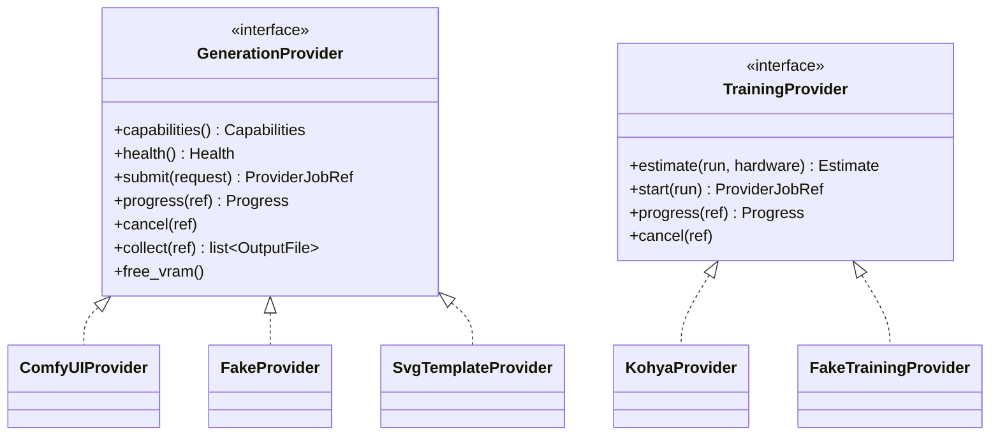

# AI Generation Architecture

## Provider adapters

- **ComfyUIProvider** (worker → ComfyUI HTTP `/prompt`, `/history`, `/view`, `/free`, plus WebSocket `/ws` for step progress).
  - It translates a domain `GenerationRequest` into ComfyUI API-format JSON using a **workflow version**: a template with declared inputs, like the prototype's `make_workflows.py`.
  - The domain never sees ComfyUI node ids.
- **SvgTemplateProvider:** deterministic SVG from versioned templates. It runs in-process with no GPU, is sanitized, and is rasterized with `resvg`.
- **FakeProvider:** returns generated test images with configurable delays and failures, for CI and UI development.
- **KohyaProvider:** runs through the host agent (see below), using presets for 6 GB taken from the prototype:
  - SDXL: UNet-only, Adafactor fused, bf16, gradient checkpointing, cached latents/TE, 768 px;
  - SD1.5: AdamW8bit, 512 px.

## GPU lane

The worker owns **one GPU lane**, so a single job uses the GPU at a time (RULE-012).

- **Before training:** call `free_vram()` on ComfyUI, then ask the host agent to stop it. Training starts only once VRAM is under the threshold.
- **After training:** restart ComfyUI, then resume generation jobs.
- **Engine unavailable:** GPU jobs stay `queued` with a reason (RULE-013); CPU jobs continue.

## Host agent

The host agent is a small native Windows service in Python, listening on 127.0.0.1 with a per-install token. Its API is **fixed and narrow**:
- `GET /health`, `GET /gpu` (nvidia-smi query);
- `POST /engine:start|stop|restart` (ComfyUI with pinned args);
- `POST /training-runs` (a validated run spec only; the agent builds the kohya command from it; no shell, no arbitrary args);
- `GET /training-runs/{id}` (progress parsed from logs), `POST /training-runs/{id}:cancel`.

It sets `PYTHONUTF8=1` (prototype S-3) and keeps kohya in its own Python 3.11 venv.

## Pose detection and background removal

| Function | Choice | Licence | Where |
|---|---|---|---|
| Pose detection | DWPose (ONNX: YOLOX detector + DW-LL pose) | Apache-2.0, code via mmpose (to confirm upstream) | worker, ONNX Runtime CPU |
| Background removal | BiRefNet | MIT | ComfyUI workflow on the GPU (D-48) |

- **Pose detection** runs on CPU: 2–4 s per image in WP-01, so it is usable while ComfyUI is stopped.
- **Background removal** runs on the GPU. On CPU it took 22–141 s and ~19 GB RAM in WP-01, so it waits for the engine like diffusion (D-48).

## Reproducibility metadata (RULE-011)

Each version stores:
- `model {id, sha256}`, `lora [{id, sha256, weight}]`;
- `workflow {id, version}`, `engine {name, version}`;
- `prompt`, `negative`, `seed`, `steps`, `cfg`, `sampler`, `scheduler`, `size`;
- `pose {id, keypoints hash, strength}`, `references [{id, sha256, weight}]`;
- `hardware {gpu, vram}`.

## Models and downloads

The registry is seeded from a **versioned catalogue file** in the repo (name, source URL, sha256, size, licence, family, VRAM). Downloads:
- need explicit approval (RULE-008);
- go to a temp file;
- are resumable with HTTP ranges and lock against duplicates;
- are verified by SHA-256, then moved into the model folder (prototype S-1).

### Implementation notes (WP-12)

- **Catalogue:** `backend/src/asset_studio/modules/models/catalogue.json` (families, licences, models with HTTPS source, SHA-256 and size). Each entry was checked against the source's LFS metadata when added. It is synced into the database when the registry is read.
- **Model folder:** the host folder `ASSET_STUDIO_MODELS_HOST_DIR` in ComfyUI's layout (`checkpoints`, `loras`, `controlnet`, `ipadapter`, `clip_vision`, `vae`) is mounted read-only into the API (scan) and read-write into the worker (downloads). DWPose files stay in `<data>/models/pose`.
- **Scan (FR-081):** a file with the catalogue's name is that model; any other model file becomes a `local` model with an unknown licence and family (the user can set the family). A size different from the catalogue marks the file as mismatched; a changed size makes a verified file unverified again.
- **Downloads (FR-082, RULE-008, NFR-007):** the user confirms file, source and size, which must equal the catalogue entry. A `download` job on the CPU lane writes `<file>.part`, resumes with `Range` (a server without ranges restarts it), refuses non-HTTPS redirects, checks the SHA-256 and only then renames the file. A wrong file is deleted; an interrupted one stays for the next attempt. One download per model at a time.
- **Checks:** `verify_model` jobs hash an installed file. Compatibility (FR-084, RULE-015): one checkpoint, add-ons of the same family, IP-Adapter needs CLIP vision, files installed and not mismatched.
- **Licences (RULE-007, FR-083):** a commercial project conflicts with any licence whose commercial use is not `allowed` (`unknown` included). The user confirms per project and model, with an optional note; it is audited and stays valid while the licence and the intended use are unchanged. `licence_gate` is the check WP-08 runs before queueing.

## Implementation notes (WP-05)

- **Code:** `backend/src/asset_studio/modules/providers/`:
  - `base.py`: the `GenerationProvider` protocol and its value types;
  - `workflows.py`: workflow templates whose declared inputs target `(node, field)` pairs, so the domain never sees node ids; inputs are type- and range-checked and fail with `WORKFLOW_INPUT_INVALID`;
  - `fake.py`: deterministic PNGs per seed, configurable steps and failures, no imaging library;
  - `comfyui.py`: `/system_stats`, `/prompt`, `/history`, `/queue`, `/interrupt`, `/view` and `/free`;
  - `engine.py`: `EngineMonitor` (health cached for 5 s) and `run_generation` (submit, follow, collect; cancels the engine job when the user cancels or the worker stops).
- **GPU lane:** the worker registers `EngineMonitor.gate` for the `gpu` lane. While the engine is down, GPU jobs stay `queued` with `wait_reason = ENGINE_UNAVAILABLE` (RULE-013) and CPU jobs keep running. The gate takes effect once GPU job handlers exist (generation in WP-08).
- **Step progress:** the adapter reports queue position and completion. Per-step progress over ComfyUI's `/ws` socket arrives with the Generation Studio (WP-08).
- **Problem codes:** `ENGINE_UNAVAILABLE` (503), `ENGINE_REJECTED` (ComfyUI refused the graph; lists the node ids), `ENGINE_ERROR`, `GENERATION_FAILED` (with the engine's message).
- **Host agent:**
  - `GET /gpu` runs `nvidia-smi` with fixed arguments;
  - `GET /engine` and `POST /engine:start|stop|restart` supervise the portable build: `python_embeded/python.exe -s ComfyUI/main.py --windows-standalone-build --listen 127.0.0.1 --port <port> --disable-auto-launch`, with `PYTHONUTF8=1`, output to `comfyui.log`, no shell and no request-supplied arguments;
  - stop terminates the process and kills it after 20 s; the agent stops the engine when it shuts down;
  - errors: `ENGINE_NOT_CONFIGURED`, `ENGINE_NOT_INSTALLED`.
- **Engine API:** `GET /api/v1/system/engine` and `POST /api/v1/system/engine/{start|stop|restart}` (user only, audited as `engine.<action>`). The top bar and the System status screen show this and explain disabled controls (DD-008).
- **Not yet:** installing the pinned ComfyUI build (WP-17), SVG templates (WP-14), training providers (WP-13).
