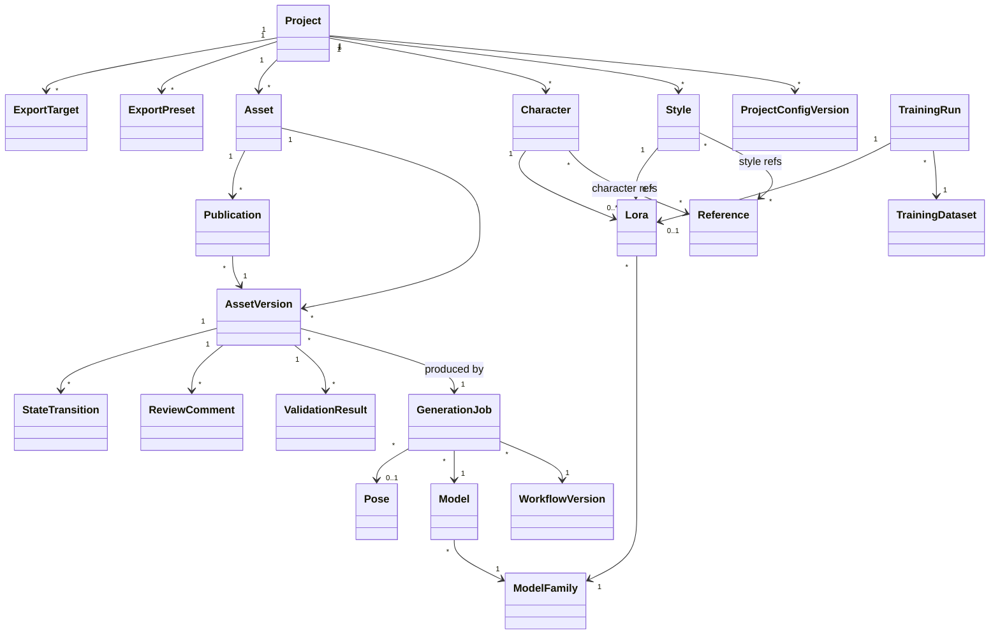

# Domain Model

## Aggregates and invariants

| Aggregate | Invariants |
|---|---|
| **Project** | the configuration validates against schema version N; every change creates a new `ProjectConfigVersion`; the `mcp_can_decide` flag defaults to false (RULE-005) |
| **Asset** | version numbers are monotonic and never reused; a version's file is immutable once written (RULE-003); `current_publication[target]` points to a `published` version |
| **AssetVersion** | its state changes only through the lifecycle state machine ([[Asset-Lifecycle]]); every transition writes a `StateTransition` plus an `AuditEntry` (RULE-006) |
| **GenerationJob** | the state machine is queued → running → completed / failed / cancelled / interrupted; a job's parameters are frozen at enqueue; it is resumable if interrupted |
| **Lora** | it has exactly one model family; only same-family models may use it (RULE-015) |
| **Publication** | it records the preset, target, files with hashes and confirmed overwrites (RULE-004) |

## Lifecycle state machine (implementation)

The state machine is one pure function `transition(version, action, actor, project_settings) -> Result`.

- It encodes T-01–T-13 and rejects anything else with a typed error, e.g. `MCP_NOT_ALLOWED` or `NOT_PUBLISHED_ONLY`.
- The API, workers and MCP all go through it, so there is no second path.
- It is covered by table-driven tests generated from [[Asset-Lifecycle]].

## Actors

The actor is `user`, `mcp` or `system`.

- The API derives the actor from the credential: the UI session gives `user`, the MCP token gives `mcp`, and the internal worker token gives `system`.
- The actor is never taken from a request field.
