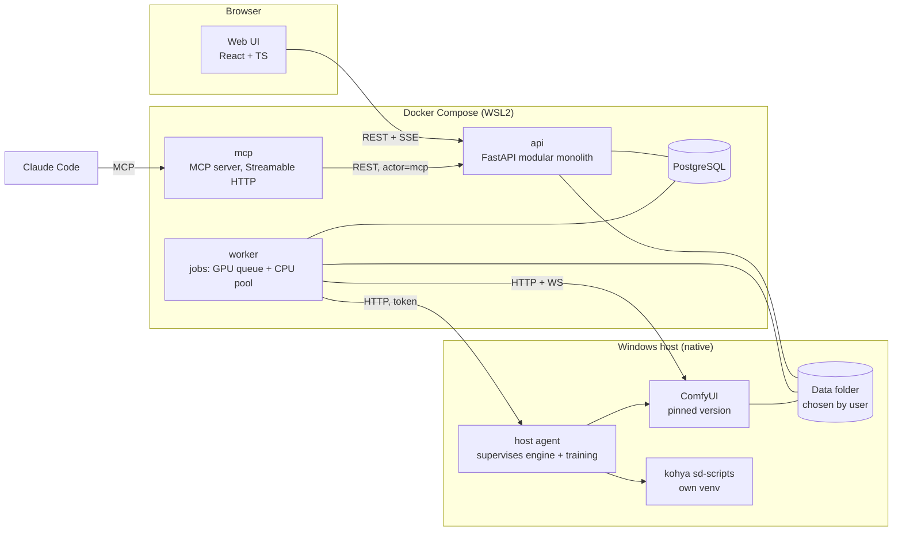

# System Architecture

> [!info] Phase 5 proposal — awaiting approval (gate G-6). No implementation before approval.

## Summary

The system is a **modular monolith in Python**, plus a React web UI, PostgreSQL and two small companions: an **MCP server** and a **host agent**.

- The application runs in **Docker Compose**.
- The **generation engine (ComfyUI)** and **LoRA training** run **natively on Windows**, under the host agent, because that is where GPU performance was measured.
- Everything listens on loopback only.

## Components

| Component | Runs | Responsibility |
|---|---|---|
| `web` | Docker (nginx serving the built SPA) | UI from the approved design ([[Design-Overview]]) |
| `api` | Docker | REST API, domain logic, validation, business rules, SSE events |
| `worker` | Docker | Persistent jobs: one GPU lane (generation, training hand-off), a CPU pool (processing, validation, export, backup) |
| `db` | Docker | PostgreSQL 17: metadata, jobs, audit. No binary files |
| `mcp` | Docker | MCP tools for Claude Code; a thin client of the REST API |
| `host-agent` | Windows (Python service) | Starts, stops and health-checks ComfyUI; runs training jobs; frees VRAM; reports the GPU |
| ComfyUI | Windows | Executes diffusion workflows (text-to-image, image-to-image, pose + reference) |

## Module boundaries (backend)

The backend is a single Python package `asset_studio` with one sub-package per module. Each module exposes a service interface and owns its tables. Other modules call that interface and never touch another module's tables.

| Module | Owns | Depends on |
|---|---|---|
| `projects` | projects, configuration versions, schema | `audit` |
| `styles` | styles, characters, LoRA links | `projects`, `references` |
| `references` | reference files and links | `storage` |
| `poses` | pose library, keypoints, detection jobs | `jobs`, `storage` |
| `models` | model registry, files, licences, downloads | `jobs` |
| `workflows` | workflow definitions and versions | `models` |
| `generation` | generation requests, compatibility checks, metadata | `styles`, `poses`, `workflows`, `jobs`, `assets` |
| `jobs` | queue, job states, recovery, events | — |
| `providers` | engine adapters (ComfyUI, fake, SVG) | — |
| `assets` | assets, versions, lifecycle state machine | `storage`, `audit` |
| `processing` | post-processing pipelines | `assets`, `providers` |
| `quality` | technical validation, reviews, comments | `assets` |
| `training` | datasets, captions, runs | `jobs`, `assets`, `models` |
| `publishing` | presets, targets, publications, file plans | `assets`, `storage` |
| `audit` | audit entries | — |
| `system` | settings, status, backup and restore | all, read-only |
| `storage` | storage abstraction | — |

Dependency rules are enforced by `import-linter` contracts in CI.

## Key decisions

| ADR | Decision |
|---|---|
| [[ADR-001-modular-monolith]] | Modular monolith, no microservices |
| [[ADR-002-python-backend]] | Python 3.12 + FastAPI for the backend |
| [[ADR-003-react-frontend]] | React + TypeScript + Vite; Radix primitives + design tokens |
| [[ADR-004-postgresql-job-queue]] | PostgreSQL for data **and** the job queue |
| [[ADR-005-hybrid-deployment]] | Docker Compose for the app; ComfyUI and training native, under a host agent |
| [[ADR-006-provider-adapters]] | Generation and training behind provider adapters |
| [[ADR-007-local-storage-layout]] | Local filesystem storage with an abstraction and an immutable version layout |
| [[ADR-008-mcp-over-api]] | MCP server as an API client over Streamable HTTP with its own actor token |
| [[ADR-009-pose-detection]] | DWPose (Apache-2.0) for pose detection |
| [[ADR-010-background-removal]] | BiRefNet (MIT) for background removal |
| [[ADR-011-training-kohya]] | kohya sd-scripts for LoRA training, presets for 6 GB |
| [[ADR-012-security-model]] | Loopback only, Host/Origin checks, per-install tokens |

## Hardware compatibility

Every capability here was measured on the reference machine (6 GB VRAM) in the Phase 0 prototype, except the items listed below. These are verified in WP-01 before the modules that depend on them.

| Item | Status |
|---|---|
| ComfyUI SDXL / pose / reference on 6 GB | ✅ measured |
| kohya SD1.5 and SDXL LoRA on 6 GB | ✅ measured (SDXL 8–20 h) |
| CUDA inside Docker (WSL2) | ✅ verified, not used for GPU work |
| Docker bind-mount speed for the data folder on NTFS | ⚠️ **to verify** (R-21) |
| DWPose and BiRefNet via ONNX Runtime on CPU in the worker (speed, quality) | ⚠️ **to verify** |
| Consistency across many different poses | ⚠️ **to verify** (R-12) |

Related: [[Domain-Model]] · [[Data-Model]] · [[API-Architecture]] · [[AI-Generation-Architecture]] · [[MCP-Architecture]] · [[Infrastructure]] · [[Security-Architecture]] · [[Storage-and-Backup]] · [[Testing-Strategy]]
