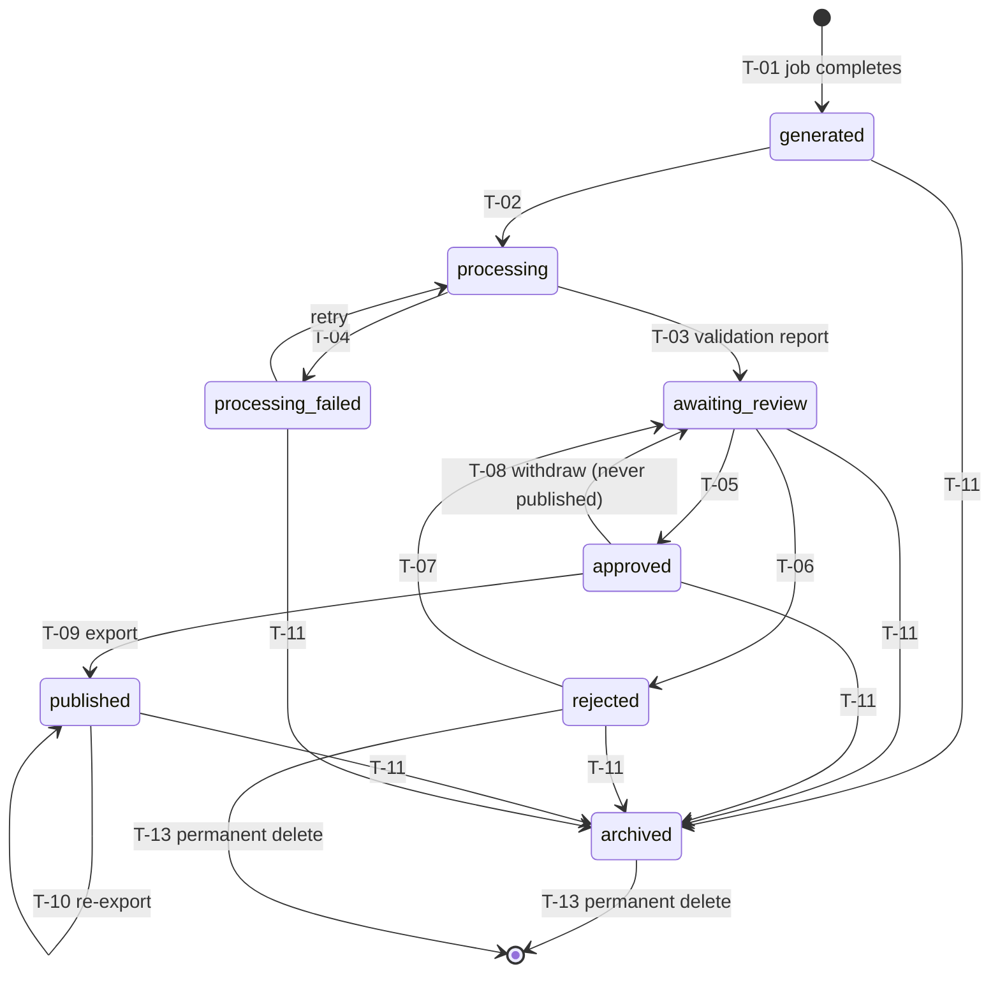

# Asset Lifecycle

- An **asset** is a logical item, and each generation or import creates a new **asset version**.
- The lifecycle status belongs to the version.
- An asset keeps a **currently published version** pointer per export target. An earlier published version stays `published` in history; there is no `superseded` state (D-41).

`archived` → the previous state (T-12) restores the version.

## Transitions

| ID | From → To | Actor | Conditions | Audit |
|---|---|---|---|---|
| T-01 | (job) → `generated` | system | job completed | job id, full generation metadata |
| T-02 | `generated` → `processing` | system | — | steps planned |
| T-03 | `processing` → `awaiting_review` | system | all steps succeeded | validation report |
| T-04 | `processing` → `processing_failed` | system | a step failed | error; retry returns to `processing` (recorded as T-04R, user or system) |
| T-05 | `awaiting_review` → `approved` | user; mcp if allowed (RULE-005) | — | actor, time |
| T-06 | `awaiting_review` → `rejected` | user; mcp if allowed | — | actor, optional reason |
| T-07 | `rejected` → `awaiting_review` | user | — | actor |
| T-08 | `approved` → `awaiting_review` | user | never published (RULE-020) | required reason |
| T-09 | `approved` → `published` | user; mcp if allowed | export preset and target | preset, target, file hash, time |
| T-10 | `published` → `published` | user | overwriting a file needs explicit confirmation (RULE-004) | overwritten file, confirmation |
| T-11 | any → `archived` | user | — | previous state |
| T-12 | `archived` → previous state | user | — | actor |
| T-13 | `rejected` / `archived` → deleted | user | confirmation; published versions must be archived first (RULE-019) | audit entry kept, file removed |

## Rules

- A new generation never overwrites an existing version (RULE-003).
- Technical validation results are informative and never replace visual review (RULE-009).
- Failure handling: failed jobs stay in the queue history (FR-040) and failed processing produces `processing_failed`. Neither leaves partial files without a version record.
