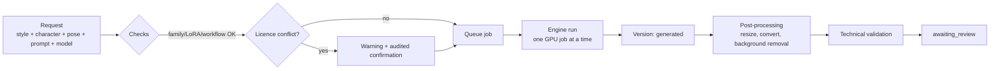

# Generation Pipeline (business view)

- The engine is unavailable or there is no GPU → the job waits with a clear status (RULE-013).
- Metadata is stored for reproducibility (RULE-011).
- Technical design: [[AI-Generation-Architecture]] (Phase 5).
