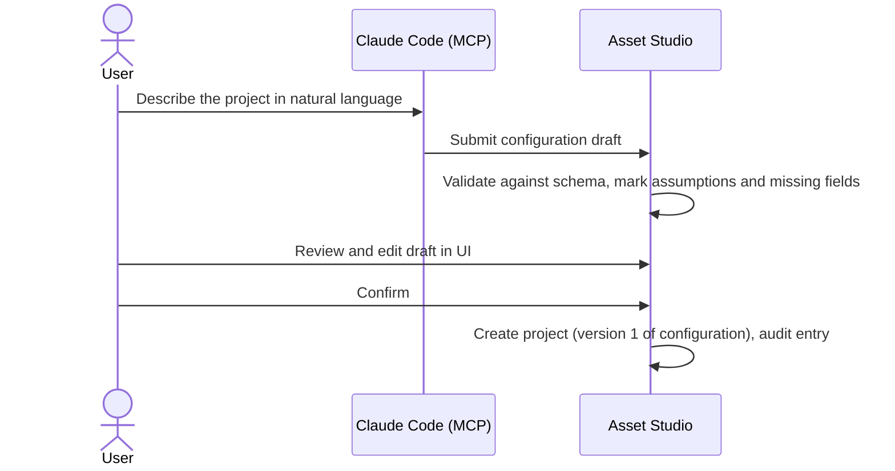

# Project Creation

- **Manual path:** the user fills in the same form in the UI (UC-001).
- **Clone / import:** start from an existing configuration (UC-003); the result is validated again (RULE-014).
- The project setting "MCP may approve/publish" starts **off** (RULE-005).
- Requirements: FR-001–FR-008 · Rules: RULE-010, RULE-014
