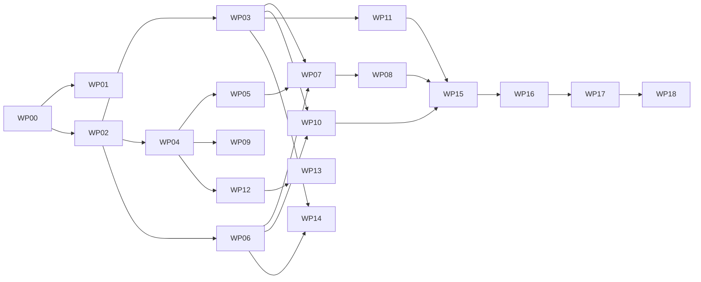

# Implementation Work Packages (approved at gate G-6, D-46)

Every package is one or more small PRs on a `feature/*` branch, reviewed by the user. Each follows the Definition of Done: tests, docs and traceability.

| WP | Objective | Requirements | Depends on | Agent / model |
|---|---|---|---|---|
| WP-00 | Repository scaffolding: backend/frontend/host-agent layout, tooling (uv, pnpm, ruff, mypy, eslint), CI on GitHub Actions without a GPU, compose skeleton, import-linter contracts | NFR-015, NFR-016 | — | infra / Sonnet |
| WP-01 | **Verification spikes** (no product code): bind-mount speed on NTFS (R-21); DWPose and BiRefNet ONNX on CPU (speed, quality, upstream licences); ComfyUI WebSocket progress; consistency across 10 different poses with pose + reference (R-12) | R-12, R-19, R-20, R-21 | WP-00 | AI / Sonnet, review Opus |
| WP-02 | Core: projects, config schema and versions, audit, actors and tokens, Host/Origin checks | FR-001–FR-008, RULE-006, RULE-018, NFR-005 | WP-00 | backend / Sonnet; security / Opus |
| WP-03 | Storage, assets, versions, lifecycle state machine and transitions API | FR-050–FR-055, RULE-003, RULE-019, RULE-020 | WP-02 | backend / Sonnet |
| WP-04 | Job queue, worker lanes, events (SSE), recovery after restart | FR-038, FR-040–FR-043, NFR-003 | WP-02 | backend / Sonnet |
| WP-05 | Provider layer: Fake, ComfyUI adapter, host agent (engine control, GPU info) | FR-030, FR-043, NFR-008 | WP-04 | AI / Sonnet; security / Opus |
| WP-06 | Frontend foundation: app shell, rail, top bar, design tokens, i18n PL/EN, generated API client | FR-125, NFR-009 | WP-02 | frontend / Sonnet |
| WP-07 | Styles, characters, references, poses (library, editor, detection) — backend + UI | FR-010–FR-026 | WP-03, WP-05, WP-06 | backend + frontend / Sonnet |
| WP-08 | Generation Studio and queue screens; workflows; compatibility and licence checks; metadata | FR-031–FR-038, RULE-007, RULE-011, RULE-015 | WP-05, WP-07 | backend + frontend / Sonnet |
| WP-09 | Processing (resize, convert, background removal), technical validation | FR-060, FR-065 | WP-04, WP-01 | backend / Sonnet |
| WP-10 | Library, asset details, review, compare screens; comments | FR-049–FR-064 | WP-03, WP-06 | frontend / Sonnet |
| WP-11 | Export presets, targets, file plan, publish with overwrite confirmation | FR-090–FR-095, RULE-004 | WP-03 | backend + frontend / Sonnet |
| WP-12 | Model registry, catalogue, approved resumable downloads, licence warnings | FR-080–FR-084, RULE-008, NFR-007 | WP-04 | backend + frontend / Sonnet |
| WP-13 | LoRA training: datasets, captions, estimates, kohya via host agent | FR-070–FR-075, RULE-016, RULE-017 | WP-05, WP-12 | AI / Sonnet |
| WP-14 | SVG generation (design UXQ-01 first, then implement) | FR-045–FR-047 | WP-03, WP-06 | frontend + backend / Sonnet |
| WP-15 | MCP server and tools | FR-120, FR-121, RULE-005, RULE-010 | WP-08, WP-10, WP-11 | MCP / Sonnet; security / Opus |
| WP-16 | Dashboard, settings, system status, audit view (UXQ-02), backup and restore | FR-100, FR-110–FR-115 | most | backend + frontend / Sonnet |
| WP-17 | Setup/start scripts for Windows, ComfyUI and training install with approval prompts | NFR-013, NFR-014 | WP-05, WP-13 | infra / Sonnet |
| WP-18 | QA hardening: E2E for AC-001–AC-015, failure scenarios, GPU integration run, docs completion | all AC | all | QA / Sonnet; final review Opus |

## Status

| WP | Status | PR |
|---|---|---|
| WP-00 | ✅ done | merged to main |
| WP-01 | ✅ done — results in [[WP-01-Spike-Report]] | #15 |
| WP-01b | ✅ done — 5 correct + 2 partial of 10; R-12 accepted as limitation (D-50) | #15 |
| WP-02 | ✅ done — projects, configuration versions, audit, actors, Host/Origin checks | #16 |
| WP-04 | 🟡 in review — job queue, worker lanes, SSE events, recovery after restart | WP-04 PR |

## Order and parallelism

These pairs can run in parallel because they touch separate modules:
- WP-03 ∥ WP-04 ∥ WP-06 after WP-02;
- WP-09 ∥ WP-10 ∥ WP-11 ∥ WP-12.

WP-01 results may change ADR-005, ADR-009 and ADR-010. Any change goes back to the user for approval.
