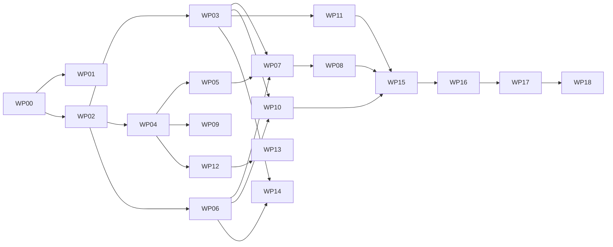

# Implementation Work Packages (approved at gate G-6, D-46)

Every package is one or more small PRs on a `feature/*` branch, reviewed by the user. Each follows the Definition of Done: tests, docs and traceability.

| WP | Objective | Requirements | Depends on | Agent / model |
|---|---|---|---|---|
| WP-00 | Repository scaffolding: backend/frontend/host-agent layout, tooling (uv, pnpm, ruff, mypy, eslint), CI on GitHub Actions without a GPU, compose skeleton, import-linter contracts | NFR-015, NFR-016 | — | infra / Sonnet |
| WP-01 | **Verification spikes** (no product code): bind-mount speed on NTFS (R-21); DWPose and BiRefNet ONNX on CPU (speed, quality, upstream licences); ComfyUI WebSocket progress; consistency across 10 different poses with pose + reference (R-12) | R-12, R-19, R-20, R-21 | WP-00 | AI / Sonnet, review Opus |
| WP-02 | Core: projects, config schema and versions, audit, actors and tokens, Host/Origin checks | FR-001–FR-008, RULE-006, RULE-018, NFR-005 | WP-00 | backend / Sonnet; security / Opus |
| WP-03 | Storage, assets, versions, lifecycle state machine and transitions API | FR-050–FR-055, RULE-003, RULE-019, RULE-020 | WP-02 | backend / Sonnet |
| WP-04 | Job queue, worker lanes, events (SSE), recovery after restart | FR-038, FR-040–FR-043, NFR-003 | WP-02 | backend / Sonnet |
| WP-05 | Provider layer: Fake, ComfyUI adapter, host agent (engine control, GPU info) | FR-030, FR-043, NFR-008 | WP-04 | AI / Sonnet; security / Opus |
| WP-06 | Frontend foundation: app shell, rail, top bar, design tokens, i18n PL/EN, generated API client | FR-125, NFR-009 | WP-02 | frontend / Sonnet |
| WP-07 | Styles, characters, references, poses (library, editor, detection) — backend + UI | FR-010–FR-026 | WP-03, WP-05, WP-06 | backend + frontend / Sonnet |
| WP-08 | Generation Studio and queue screens; workflows; compatibility and licence checks; metadata | FR-031–FR-038, RULE-007, RULE-011, RULE-015 | WP-05, WP-07 | backend + frontend / Sonnet |
| WP-09 | Processing (resize, convert, background removal), technical validation | FR-060, FR-065 | WP-04, WP-01 | backend / Sonnet |
| WP-10 | Library, asset details, review, compare screens; comments | FR-049–FR-064 | WP-03, WP-06 | frontend / Sonnet |
| WP-11 | Export presets, targets, file plan, publish with overwrite confirmation | FR-090–FR-095, RULE-004 | WP-03 | backend + frontend / Sonnet |
| WP-12 | Model registry, catalogue, approved resumable downloads, licence warnings | FR-080–FR-084, RULE-008, NFR-007 | WP-04 | backend + frontend / Sonnet |
| WP-13 | LoRA training: datasets, captions, estimates, kohya via host agent | FR-070–FR-075, RULE-016, RULE-017 | WP-05, WP-12 | AI / Sonnet |
| WP-14 | SVG generation (design UXQ-01 first, then implement) | FR-045–FR-047 | WP-03, WP-06 | frontend + backend / Sonnet |
| WP-15 | MCP server and tools | FR-120, FR-121, RULE-005, RULE-010 | WP-08, WP-10, WP-11 | MCP / Sonnet; security / Opus |
| WP-16 | Dashboard, settings, system status, audit view (UXQ-02), backup and restore | FR-100, FR-110–FR-115 | most | backend + frontend / Sonnet |
| WP-17 | Setup/start scripts for Windows, ComfyUI and training install with approval prompts | NFR-013, NFR-014 | WP-05, WP-13 | infra / Sonnet |
| WP-18 | QA hardening: E2E for AC-001–AC-015, failure scenarios, GPU integration run, docs completion | all AC | all | QA / Sonnet; final review Opus |

## Status

| WP | Status | PR |
|---|---|---|
| WP-00 | ✅ done | merged to main |
| WP-01 | ✅ done — results in [[WP-01-Spike-Report]] | #15 |
| WP-01b | ✅ done — 5 correct + 2 partial of 10; R-12 accepted as limitation (D-50) | #15 |
| WP-02 | ✅ done — projects, configuration versions, audit, actors, Host/Origin checks | #16 |
| WP-03 | ✅ done — storage, assets, versions, lifecycle and transitions API; regeneration (FR-052) moves to WP-08 with the job pipeline | #17 |
| WP-04 | ✅ done — job queue, worker lanes, SSE events, recovery after restart | #18 |
| WP-06 | ✅ done — app shell (rail, top bar, phone bar), Ctrl K palette, design tokens and base styles, PL/EN at runtime, theme switch, client generated from OpenAPI | #19 |
| WP-05 | ✅ done — provider layer (Fake, ComfyUI adapter, workflow templates), engine status and GPU-lane gate, host agent engine control and GPU info | #20 |
| WP-07 | ✅ done — styles and characters (attributes, versions, archive), references (validated upload, roles, links), pose library with built-in poses, skeleton editor, `detect_pose` job running DWPose on the CPU (models installed by a checked installer) with a drawn-box fallback. FR-016 LoRA moves to WP-13 | #21 |
| WP-12 | ✅ done — taken before WP-08 (D-52): versioned model catalogue, registry with install state from the shared model folder, approved resumable downloads with SHA-256, file checks, licence warnings with audited confirmation, compatibility checks, Models screen | #22 |
| WP-09 | ✅ done — processing after generation: optional background removal (BiRefNet through ComfyUI's native nodes, GPU lane), background fill, resize (contain/cover/none), convert, optimise, thumbnail and preview; technical validation (integrity, format, dimensions, aspect ratio, file size, transparency/background, naming) kept per run; `processing_failed` with the error and retry (T-04R); project `processing` and `validation` settings (D-54) | #25 |
| WP-13 | 🟡 part 1 done — training datasets from approved versions and uploads with captions, presets for small GPUs, time estimate with the SDXL warning, the `train` job through the host agent (kohya) with progress and cancel, the GPU handed over from ComfyUI and back, the LoRA registered with its family; LoRA training screen (D-60). Part 2: LoRA links to styles and characters, LoRAs in generation | #32 |
| WP-16 | ✅ done — part 2: Projects (list with counts, Claude's drafts, import, open, export, archive), New project (configuration editor with live schema check, drafts that only the user confirms or discards) and Project settings (configuration versions with compare and restore, breaking-change confirmation, Claude's permission, clone, export, archive) (D-59). Part 1: Dashboard (attention cards, versions by state, latest versions, failures, recent activity, quick actions), Settings with General (theme, language, queue pause), Data and backup (locations without host paths, backups with create and restore), MCP connection and Audit log (UXQ-02); System status (components, consistency, last backup); queue pause; backup and restore jobs with a verified manifest (AC-009); a remembered project that no longer exists is forgotten (D-58) | #30, #31 |
| WP-15 | ✅ done — MCP server (Streamable HTTP on loopback, `mcp` compose service without database or volumes) with the designed tools plus `generate_check`, `review_queue`, `asset_image`, `style_list`, `character_list` and `publish_options`; the API's rules apply to Claude unchanged (RULE-004, RULE-005, RULE-010) and refusals carry their code (FR-121); `Idempotency-Key` for job-creating POSTs, required for MCP; `POST /projects:validate`, `PUT /projects/drafts/{id}`, `GET /workflows` (D-57) | #29 |
| WP-11 | ✅ done — export presets (format, sizes, naming and folder patterns, background, fit, optimisation, metadata sidecar), targets under configured export roots, file plans with overwrite flags, publishing with each overwrite confirmed by path and checked again (RULE-004), publications with file hashes and the current-publication pointer, `export` job, MCP publishing only when allowed and never overwriting (RULE-005); Export and publish screen, Publish in the library, publications in asset details (D-56) | #28 |
| WP-10 | ✅ done — Asset Library (search, filters by state, category, style, character, collection and tag, sort, adjustable tiles, favourites, multi-select to add to a collection, compare or archive), Asset details (published or newest version, version history with actions, tags with suggestions, collections, regeneration, audit trail), Review (pending versions oldest first, large preview, validation, duplicates, comments incl. Claude's, metadata, approve and reject with an optional reason) and Compare (side by side, swipe, overlay, linked zoom and pan, parameter diff); review comments, collections, tags, favourites and duplicate detection in the backend (D-55) | #26 |
| WP-08 | ✅ done — PR 1: generation backend: built-in workflows (text/image-to-image, OpenPose pose, IP-Adapter reference, VAE), checks, licence gate, queueing with variants and batches, GPU job with step progress over `/ws`, versions with RULE-011 metadata, regeneration. PR 2: Generation Studio (single and batch requests, live checks before queueing, jobs from the screen with step progress and cancel, versions with regeneration) and Queue (state filters, GPU and reason for waiting, progress, errors, cancel, retry and resume). Queue pause and reorder deferred (D-53) | #23, #24 |

## Order and parallelism

These pairs can run in parallel because they touch separate modules:
- WP-03 ∥ WP-04 ∥ WP-06 after WP-02;
- WP-09 ∥ WP-10 ∥ WP-11 ∥ WP-12.

WP-01 results may change ADR-005, ADR-009 and ADR-010. Any change goes back to the user for approval.
